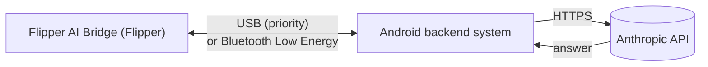

# Flipper AI Bridge

Ask an AI from a Flipper Zero. The Flipper has no Wi-Fi, so an Android phone acts as the bridge: the Flipper sends the question over Bluetooth Low Energy or USB, the phone asks the Anthropic API (Claude models) and sends the answer back to the Flipper screen.

Polish version: [README.pl.md](README.pl.md)

## Features

- Chat on the Flipper screen: on-screen keyboard, chat strip above the input line, scrolling.
- Bluetooth Low Energy and USB. When the Flipper is plugged into the phone with USB, USB is used automatically, even if Bluetooth is also on.
- The Chat and New chat menu entries are greyed out until the Flipper detects the phone app. The menu shows `Phone app not detected` at the bottom.
- Word and phrase hints while typing, in English and Polish (English, Polish or both). They learn from what you write. Hold OK to accept a hint.
- Two saved chats. Starting a new chat when both slots are used replaces the oldest one. Each chat is limited to 500 KB.
- Android app: API key stored encrypted (Android Keystore, AES-256-GCM) and shown as dots, model picker (Sonnet 5.5, Haiku 5.5, Opus 5.5), effort picker (low, medium, high), runs with the screen off without wake locks or polling.
- In-app updates for the phone app with SHA-256 verification, and one-tap `Install on Flipper` / `Update on Flipper` for the Flipper app. Chats, settings and the API key are kept.

## How it works

## Repository layout

| Path | Content |
| --- | --- |
| `flipper-app/` | Flipper Zero app (C, `ufbt`) |
| `android-app/` | Android app (Kotlin, Jetpack Compose) |
| `release/` | Prebuilt `ai_bridge.fap` |
| `tools/` | Dictionary generator and signing key helper |
| `.github/workflows/` | CI that builds the APK and the `.fap`, and publishes releases |

Branches: `main` is stable, `beta` receives new changes for testing.

## Install

1. Download `flipper-ai-bridge.apk` from the [Releases](../../releases) page and install it on the phone. Allow installing from this source if asked.
2. Open the phone app, grant the permissions, enter your Anthropic API key, press `Start`.
3. Put the Flipper app on the Flipper, either:
   - in the phone app press `Install on Flipper` (Flipper connected over USB or Bluetooth, AI Bridge not running on the Flipper), or
   - copy `ai_bridge.fap` to `SD:/apps/<folder>/` with qFlipper or lab.flipper.net. The dictionaries are bundled inside the `.fap` and unpacked by the Flipper at the first start.
4. Bluetooth: in the phone app press `Scan for Flipper` and pick your Flipper (paired devices are listed too). A Flipper already connected to the phone does not advertise, so it only shows up in the paired list. Accept the pairing PIN.
5. USB: plug the Flipper into the phone (OTG). Accept the USB permission once.
6. On the Flipper open the app and choose `Chat`.

### Flipper controls

| Key | Action |
| --- | --- |
| D-pad | Move over the keyboard. Up from the top row selects the chat strip, then Up/Down scroll |
| OK | Press the key |
| Hold OK | Accept the hint |
| Back | Delete a character. When the input is empty: back to the menu |
| Hold Back | Back to the menu |

Bottom keyboard row: layer (`abc`, `ABC` for one letter, `PL1` for Polish letters, digits and symbols), `Del`, `Space`, `Tab` (accept hint), `Send`. The Flipper font has no Polish letters, so they are shown without accents on the screen, but the text sent to the AI keeps them.

### Language

The official Flipper firmware has no interface language setting that apps can read, so the hint language is set in the app (`Settings -> Hints language`). The default is English. The app interface is in English. The AI answers in Polish or English (the language you write in) and in English for any other language.

## Updates and checksums

Always update in this order: first the phone app, then the Flipper app. When both have an update, the phone app has to be updated first. The `Update on Flipper` button stays disabled until the phone app is up to date.

The phone app asks GitHub for the newest release when it opens (and on `Check for updates`). A new version is only offered when its version number is higher than the installed one. Beta releases are included only if you switch that on.

Before anything is installed, the file is downloaded and its SHA-256 is compared with the digest GitHub reports for that asset and with the `SHA256SUMS` file of the release. If either is missing, or they disagree, or the hash does not match, nothing is installed. The Flipper app upload is also verified with an MD5 check on the Flipper.

This protects against corrupted or swapped files. It cannot protect against someone who controls this repository, so keep the repository and its secrets safe. Android additionally refuses an APK signed with a different key than the installed app.

### Signing key (needed for in-app updates)

Android installs an update only if it is signed with the same key as the installed app. The release workflow therefore needs a permanent key:

1. Run `tools/make_keystore.sh` once (needs `keytool`, part of any JDK).
2. Add the four secrets it prints to the repository (`ANDROID_KEYSTORE_BASE64`, `ANDROID_KEYSTORE_PASSWORD`, `ANDROID_KEY_ALIAS`, `ANDROID_KEY_PASSWORD`).
3. Keep the `.jks` file safe. Losing it means users must uninstall once to update.

Without the secrets the APK is signed with a temporary key and can only be installed fresh.

## Protocol

Both links carry one UTF-8 message per line (`\n` inside text is written as `\\n`):

| Direction | Line | Meaning |
| --- | --- | --- |
| Phone to Flipper | `H` | Hello, the phone app is here |
| Flipper to phone | `P` | Ping, answered with `H` |
| Flipper to phone | `N` | New conversation |
| Flipper to phone | `U:<text>` / `B:<text>` | Earlier user / AI message (context replay when a saved chat is resumed) |
| Flipper to phone | `Q:<lang>:<text>` | Question (`lang` is `en`, `pl` or `both`) |
| Phone to Flipper | `S:<text>` | Status |
| Phone to Flipper | `A:<chunk>` | Part of the answer |
| Phone to Flipper | `E` | End of the answer |
| Phone to Flipper | `X:<text>` | Error |

Installing the Flipper app uses the Flipper's own protobuf RPC (storage service) instead of this protocol.

## Security

- The API key is stored encrypted with a non-exportable Android Keystore key, shown only as dots, and sent only to `https://api.anthropic.com`. Backups are disabled.
- Chat history on the Flipper is stored on the SD card as plain text.
- The Bluetooth link uses Flipper pairing with a PIN.

## Notes

- The apps were written without access to the hardware, so test them on your devices and report problems.
- The Flipper UI layout (128x64 px) may need small adjustments after the first real test.
- Flipper AI Bridge is an independent community project and is not affiliated with or endorsed by Anthropic. "Claude" is a trademark of Anthropic and is used here only to name the models that the Anthropic API provides.
