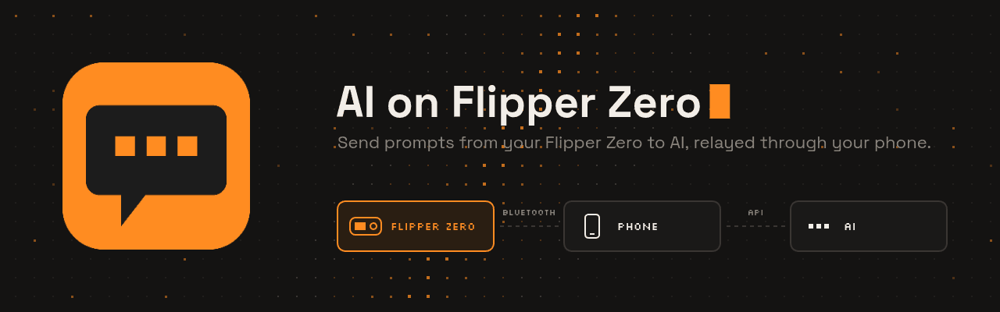
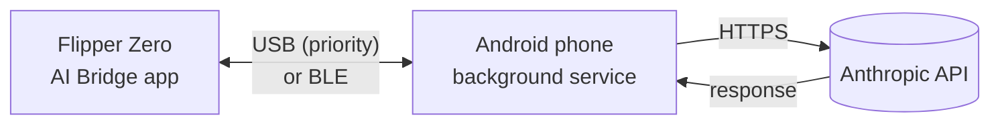

# Flipper AI Bridge

Ask AI questions from the Flipper Zero. The Flipper sends queries to an intermediary (your Android phone). The Flipper sends the question over Bluetooth Low Energy or USB, the phone queries the Anthropic API (Claude models) and sends the answer back to the Flipper's screen.

Polish version: [README.md](README.pl.md)

## Features

- Chat on the Flipper's screen: on-screen keyboard, a chat bar above the input field, scrolling.
- Bluetooth Low Energy and USB. When the Flipper is connected to the phone with a USB cable, USB is used automatically, even if Bluetooth is also enabled.
- Word and sentence suggestions in Polish and English (English, Polish, or both). They learn from what you type. Hold **OK** to accept a suggestion.
- Two saved conversations. A new chat, when both slots are taken, replaces the oldest one. Each chat has a 500 KB limit.
- Android app: encrypted API key (Android Keystore, AES-256-GCM), model selection (Sonnet 5.5, Haiku 5.5, Opus 5.5), effort selection (low, medium, high), works with the screen turned off.
- App updates on the phone with SHA-256 verification, and one-button installation for the app installed on the Flipper.

## How it works

## Repository structure

| Path | Contents |
| --- | --- |
| `flipper-app/` | Flipper Zero app |
| `android-app/` | Android app |
| `release/` | Ready-made `ai_bridge.fap` |
| `tools/` | Helper-word generator and signing key script |
| `.github/workflows/` | Actions that build the `APK` and `.fap` and publish releases |

> [!WARNING] 
> Branches: `main` is the stable version, `beta` receives new changes for testing.

## Installation

1. Download `flipper-ai-bridge.apk` from the [Releases](https://github.com/Nahida4479/Flipper-AI-Bridge/releases) page and install it on your phone. 
2. Open the app on your phone, grant permissions, enter your Anthropic API key and press `Start`.
3. Install the app on the Flipper in one of two ways:
   - in the phone app press `Install on Flipper` (Flipper connected via USB or Bluetooth), or
   - copy `ai_bridge.fap` to `SD:/apps/<folder>/` using qFlipper or lab.flipper.net. The helper-word mechanism is built into the `.fap` and the Flipper unpacks it on first launch.
4. **Bluetooth:** on the phone press `Scan for Flipper` and choose the Flipper from the list.
5. **USB:** connect the Flipper to the phone. Accept the one-time USB permission.
6. On the Flipper, launch the app and choose `Chat`.

### Controls on the Flipper

| Button | Action |
| --- | --- |
| D-pad | Moving around the keyboard. |
| OK | Pressing a key |
| Hold OK | Accepting a suggestion |
| Back | Deleting a character. With an empty field: return to the menu |
| Hold Back | Return to the menu |

### Language

The official Flipper firmware does not give apps access to the interface language setting, so the ****hints language** is set in the app (`Settings -> Hints language`). **English by default**. The app interface is in English. The AI answers in Polish or English (in the language of the question), and in English for other languages.

## Updates and checksums

The phone app asks GitHub for the latest release on opening (and after `Check for updates`). Beta versions are taken into account only after enabling that option.

Before installation the file is downloaded and its SHA-256 is compared with the `SHA256SUMS` file from the releases. If any sum is missing, they do not match, or the hash does not match, nothing is installed. Installing the app on the Flipper is additionally verified with an MD5 sum on the Flipper.

## Security

- The API key is stored __encrypted with an Android Keystore key__ that cannot be exported, shown only as dots and sent only to `https://api.anthropic.com`.
- Chat history on the Flipper is stored on the SD card as plain text.
- The Bluetooth link uses Flipper pairing with a PIN code.

## License 
[MIT](./LICENSE) license