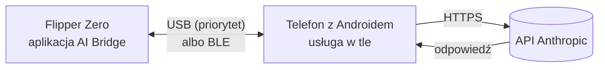
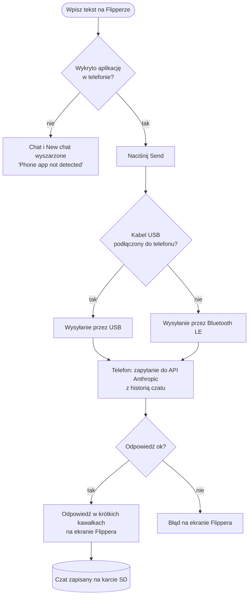
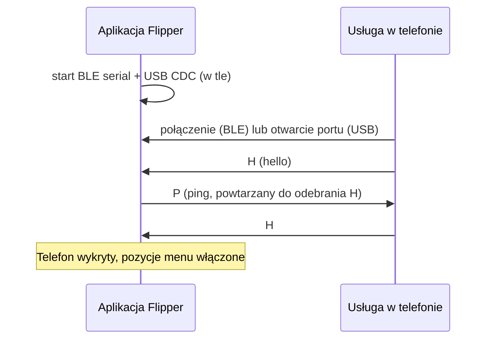
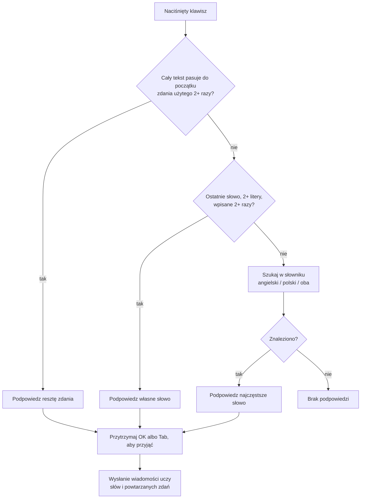
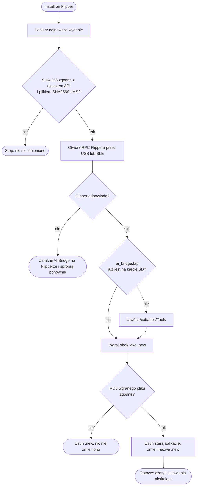

# Flipper AI Bridge

Zadawaj pytania AI z Flippera Zero. Flipper nie ma Wi-Fi, więc pośrednikiem jest telefon z Androidem: Flipper wysyła pytanie przez Bluetooth Low Energy (BLE) lub USB, telefon pyta API Anthropic (modele Claude) i odsyła odpowiedź na ekran Flippera.

English version: [README.md](README.md)

## Funkcje

- Czat na ekranie Flippera: klawiatura ekranowa, pasek z czatem nad polem wpisywania, przewijanie.
- Bluetooth Low Energy i USB. Gdy Flipper jest podłączony do telefonu kablem USB, automatycznie używane jest USB, nawet jeśli Bluetooth też jest włączony.
- Pozycje Chat i New chat w menu są wyszarzone, dopóki Flipper nie wykryje aplikacji w telefonie. Na dole menu widać `Phone app not detected`.
- Podpowiedzi słów i zdań po polsku i angielsku (angielski, polski albo oba). Uczą się z tego, co piszesz. Przytrzymaj OK, aby przyjąć podpowiedź.
- Dwie zapisane rozmowy. Nowy czat przy zajętych obu miejscach zastępuje najstarszy. Każdy czat ma limit 500 KB.
- Aplikacja na Androida: klucz API zaszyfrowany (Android Keystore, AES-256-GCM) i pokazany jako kropki, wybór modelu (Sonnet 5.5, Haiku 5.5, Opus 5.5), wybór effort (low, medium, high), działa przy wygaszonym ekranie bez wake locków i odpytywania.
- Aktualizacje aplikacji w telefonie z weryfikacją SHA-256 oraz instalacja jednym przyciskiem `Install on Flipper` / `Update on Flipper` dla aplikacji na Flippera. Czaty, ustawienia i klucz API zostają.

## Jak to działa

### Zadawanie pytania

### Wykrywanie aplikacji w telefonie

### Podpowiedzi słów i zdań

### Instalacja i aktualizacja aplikacji Flippera z telefonu

## Struktura repozytorium

| Ścieżka | Zawartość |
| --- | --- |
| `flipper-app/` | Aplikacja na Flippera Zero (C, `ufbt`) |
| `android-app/` | Aplikacja na Androida (Kotlin, Jetpack Compose) |
| `release/` | Gotowy `ai_bridge.fap` |
| `tools/` | Generator słowników i skrypt klucza podpisu |
| `.github/workflows/` | CI budujące APK i `.fap` oraz publikujące wydania |

Gałęzie: `main` to wersja stabilna, `beta` dostaje nowe zmiany do testów.

## Instalacja

1. Pobierz `flipper-ai-bridge.apk` ze strony [Releases](../../releases) i zainstaluj w telefonie. Zezwól na instalację z tego źródła, jeśli system zapyta.
2. Otwórz aplikację w telefonie, nadaj uprawnienia, wpisz klucz API Anthropic i naciśnij `Start`.
3. Wgraj aplikację na Flippera na jeden z dwóch sposobów:
   - w aplikacji w telefonie naciśnij `Install on Flipper` (Flipper połączony przez USB lub Bluetooth, AI Bridge nie uruchomiony na Flipperze), albo
   - skopiuj `ai_bridge.fap` do `SD:/apps/<folder>/` przez qFlipper lub lab.flipper.net. Słowniki są wbudowane w `.fap` i Flipper rozpakowuje je przy pierwszym starcie.
4. Bluetooth: w telefonie naciśnij `Scan for Flipper` i wybierz Flippera (lista zawiera też sparowane urządzenia). Flipper już połączony z telefonem się nie reklamuje, więc widać go tylko na liście sparowanych. Zaakceptuj PIN parowania.
5. USB: podłącz Flippera do telefonu (OTG). Zaakceptuj uprawnienie USB jednorazowo.
6. Na Flipperze uruchom aplikację i wybierz `Chat`.

### Sterowanie na Flipperze

| Przycisk | Akcja |
| --- | --- |
| Krzyżak | Poruszanie po klawiaturze. W górę z górnego rzędu wybiera pasek czatu, potem góra/dół przewija |
| OK | Wciśnięcie klawisza |
| Przytrzymaj OK | Przyjęcie podpowiedzi |
| Back | Kasowanie znaku. Przy pustym polu: powrót do menu |
| Przytrzymaj Back | Powrót do menu |

Dolny rząd klawiatury: warstwa (`abc`, `ABC` na jedną literę, `PL1` polskie litery, cyfry i symbole), `Del`, `Space`, `Tab` (przyjmij podpowiedź), `Send`. Czcionka Flippera nie ma polskich liter, więc na ekranie są bez ogonków, ale do AI trafia tekst z nimi.

### Język

Oficjalny firmware Flippera nie udostępnia aplikacjom ustawienia języka interfejsu, więc język podpowiedzi ustawia się w aplikacji (`Settings -> Hints language`). Domyślnie angielski. Interfejs aplikacji jest po angielsku. AI odpowiada po polsku lub angielsku (w języku pytania), a przy innych językach po angielsku.

## Aktualizacje i sumy kontrolne

Aplikacja w telefonie pyta GitHuba o najnowsze wydanie przy otwarciu (i po `Check for updates`). Nowa wersja jest proponowana tylko wtedy, gdy ma wyższy numer niż zainstalowana. Wersje beta są uwzględniane tylko po włączeniu opcji.

Przed instalacją plik jest pobierany, a jego SHA-256 porównywane z digestem podanym przez GitHub dla tego pliku oraz z plikiem `SHA256SUMS` z wydania. Jeśli którejś sumy brakuje, są niezgodne albo hash się nie zgadza, nic nie jest instalowane. Wgranie aplikacji na Flippera jest dodatkowo sprawdzane sumą MD5 na Flipperze.

To chroni przed uszkodzonym lub podmienionym plikiem. Nie chroni przed kimś, kto kontroluje to repozytorium, więc dbaj o repozytorium i jego sekrety. Dodatkowo Android odrzuci APK podpisany innym kluczem niż zainstalowana aplikacja.

### Klucz podpisu (potrzebny do aktualizacji w aplikacji)

Android zainstaluje aktualizację tylko, gdy jest podpisana tym samym kluczem co zainstalowana aplikacja. Workflow wydań potrzebuje więc stałego klucza:

1. Uruchom raz `tools/make_keystore.sh` (wymaga `keytool` z dowolnego JDK).
2. Dodaj do repozytorium cztery sekrety, które wypisze (`ANDROID_KEYSTORE_BASE64`, `ANDROID_KEYSTORE_PASSWORD`, `ANDROID_KEY_ALIAS`, `ANDROID_KEY_PASSWORD`).
3. Przechowuj plik `.jks` w bezpiecznym miejscu. Jego utrata oznacza, że użytkownicy muszą raz odinstalować aplikację, żeby ją zaktualizować.

Bez sekretów APK jest podpisany kluczem tymczasowym i da się go tylko zainstalować od nowa.

## Protokół

Oba łącza przesyłają jedną wiadomość UTF-8 na linię (`\n` w tekście zapisywane jako `\\n`):

| Kierunek | Linia | Znaczenie |
| --- | --- | --- |
| Telefon do Flippera | `H` | Hello, aplikacja w telefonie jest |
| Flipper do telefonu | `P` | Ping, odpowiedź to `H` |
| Flipper do telefonu | `N` | Nowa rozmowa |
| Flipper do telefonu | `U:<tekst>` / `B:<tekst>` | Wcześniejsza wiadomość użytkownika / AI (odtworzenie kontekstu po wznowieniu czatu) |
| Flipper do telefonu | `Q:<lang>:<tekst>` | Pytanie (`lang` to `en`, `pl` albo `both`) |
| Telefon do Flippera | `S:<tekst>` | Status |
| Telefon do Flippera | `A:<kawałek>` | Część odpowiedzi |
| Telefon do Flippera | `E` | Koniec odpowiedzi |
| Telefon do Flippera | `X:<tekst>` | Błąd |

Instalacja aplikacji na Flippera używa własnego protokołu RPC Flippera (protobuf, usługa storage), a nie tego protokołu.

## Bezpieczeństwo

- Klucz API jest zapisany zaszyfrowany kluczem Android Keystore, którego nie da się wyeksportować, pokazywany tylko jako kropki i wysyłany wyłącznie do `https://api.anthropic.com`. Kopie zapasowe są wyłączone.
- Historia czatu na Flipperze leży na karcie SD jako zwykły tekst.
- Łącze Bluetooth używa parowania Flippera z kodem PIN.

## Uwagi

- Aplikacje powstały bez dostępu do sprzętu, więc przetestuj je na swoich urządzeniach i zgłoś problemy.
- Układ interfejsu Flippera (128x64 px) może wymagać drobnych poprawek po pierwszym teście.
- Flipper AI Bridge to niezależny projekt społecznościowy, niepowiązany z Anthropic ani przez Anthropic niepopierany. „Claude” jest znakiem towarowym Anthropic i jest tu użyty wyłącznie do nazwania modeli udostępnianych przez API Anthropic.
